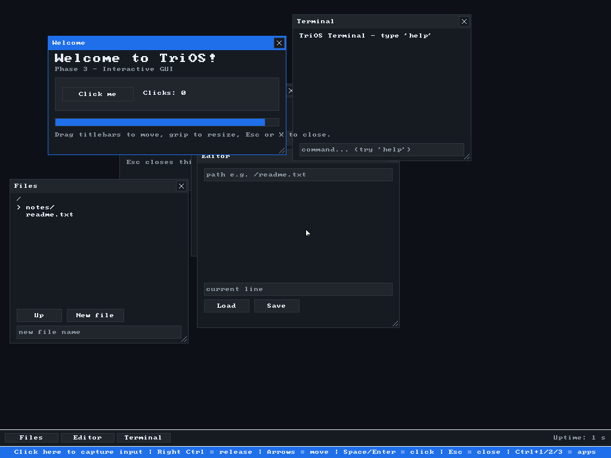
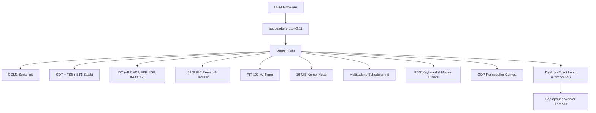

> [!NOTE]
> **TriOS is an open-source x86_64 operating system written in Rust:** boots under UEFI into an interactive graphical desktop with preemptive multitasking, a window manager, terminal, file explorer, and text editor.

<div align="center">

# TriOS

### An operating system merging the best of Windows, Linux and Android — written in Rust from scratch.

**Developed by [JOJIN JOHN](https://github.com/jojin1709)**

<p><strong>no_std x86_64 &nbsp;•&nbsp; UEFI Native &nbsp;•&nbsp; Preemptive Scheduler &nbsp;•&nbsp; Composited GUI Desktop</strong></p>

```powershell
# Build and run the interactive GUI directly in VirtualBox
cargo build --release
powershell -ExecutionPolicy Bypass -File .\run-gui.ps1
```

---

[](https://www.rust-lang.org/)
[](https://doc.rust-lang.org/nightly/rustc/platform-support/x86_64-unknown-none.html)
[](https://crates.io/crates/bootloader)
[](LICENSE)

---

</div>

> [!TIP]
> **Visual Live Demo:** Run `powershell -ExecutionPolicy Bypass -File .\run-gui.ps1` to open the active VirtualBox window directly with full mouse & keyboard controls.

## Table of Contents

- [Overview](#overview)
- [Architecture & Status](#architecture--status)
- [Key Features](#key-features)
- [Live Preview](#live-preview)
- [Quick Start](#quick-start)
  - [Prerequisites](#prerequisites)
  - [Build](#build)
  - [Run in VirtualBox](#run-in-virtualbox)
- [Desktop & Controls](#desktop--controls)
  - [Keyboard Shortcuts](#keyboard-shortcuts)
  - [Mouse & Keyboard Fallback](#mouse--keyboard-fallback)
- [Project Layout](#project-layout)
- [Boot Sequence](#boot-sequence)
- [Roadmap](#roadmap)
- [License](#license)

---

## Overview

TriOS is a modern, bare-metal operating system built from the ground up in Rust without any standard library (`#![no_std]`). It boots via UEFI into a 32-bit color GOP framebuffer, initializes hardware interrupt controllers, programs the timer, sets up virtual memory with a 16 MiB heap, and boots into a fully interactive graphical window manager powered by an event-driven loop and a preemptive multitasking kernel scheduler.

---

## Architecture & Status

TriOS has completed **Phase 0 through Phase 5**:

| Phase | Milestone | Status | Key Subsystems |
| :--- | :--- | :---: | :--- |
| **Phase 0** | Bootloader & Image Build | **Done** | UEFI boot, direct physical memory map, dual-target cargo workspace |
| **Phase 1** | Bare-Metal CPU Core | **Done** | GDT/TSS with IST1 stack, IDT, 8259 PIC remapping, PIT 100 Hz, COM1 UART serial, 16 MiB heap |
| **Phase 2** | Framebuffer & Graphics | **Done** | Double-buffered GOP canvas, 8×8 bitmap font renderer, drawing primitives |
| **Phase 3** | Input & Window Manager | **Done** | PS/2 keyboard & mouse drivers, event queue, z-ordered window manager (drag, resize, focus, close) |
| **Phase 4** | Shell, VFS & Text Fields | **Done** | In-memory RAM filesystem (`ramfs`), TextInput widgets, Files Explorer, Text Editor, Terminal shell |
| **Phase 5** | Preemptive Multitasking | **Done** | Thread control blocks, cooperative/preemptive scheduler, context switching (`switch_context`), background worker |
| **Phase 6** | User Descriptors & Syscalls | **Done** | GDT User DPL-3 code/data, TSS RSP0 privilege stack, IA32_EFER/STAR/LSTAR/FMASK MSRs, fast `syscall` dispatcher |

---

## Key Features

- **Preemptive Kernel Multitasking**: Round-robin thread scheduler running background threads concurrently with the desktop GUI event loop.
- **Interactive Window Manager**: Real-time window dragging, resizing via bottom-right grip, focus switching, and z-ordering.
- **Built-in Shell Applications**:
  - **Terminal**: Interactive CLI supporting commands (`help`, `uptime`, `clear`).
  - **Files Explorer**: Interactive directory browsing of the in-memory virtual filesystem.
  - **Text Editor**: Live text buffer editing with load and save integration into `ramfs`.
  - **Welcome & Playground**: Demo widgets showcasing buttons, click counters, sliders, and progress bars.
- **Dual Input Drivers**: Native PS/2 mouse and keyboard decoders with automatic arrow-key keyboard mouse emulation if hypervisor mouse capture is unavailable.
- **Hardware Telemetry & Logging**: Real-time TSC calibration, COM1 serial output, and per-frame performance tracking.

---

## Live Preview

<div align="center">



*Live TriOS desktop running inside VirtualBox: Welcome, Terminal, Files Explorer, Editor, and bottom Taskbar.*

</div>

---

## Quick Start

### Prerequisites

| Tool | Version / Notes |
| :--- | :--- |
| **Rust Nightly** | Pinned in `rust-toolchain.toml` (auto-installed by rustup) |
| **Target `x86_64-unknown-none`** | Bare-metal kernel target |
| **Oracle VirtualBox** | Version 7.x (verified with 7.2.14) |

### Build

```powershell
# Clone and enter directory
cd D:\trios

# Build release UEFI disk image (recommended)
cargo build --release
```

The UEFI disk image will be generated at:
`target/release/trios-uefi-release.img`

### Run in VirtualBox

```powershell
# Option A: Launch directly into interactive GUI window
powershell -ExecutionPolicy Bypass -File .\run-gui.ps1

# Option B: Run automated test harness (headless with scancode injection)
powershell -ExecutionPolicy Bypass -File .\run-virtualbox.ps1
```

> [!NOTE]
> All VirtualBox machine state is stored cleanly inside `.vbox-home/` in the workspace without polluting your global user directories.

---

## Desktop & Controls

### Keyboard Shortcuts

| Shortcut | Action |
| :--- | :--- |
| **Ctrl + 1** | Focus and open **Files Explorer** |
| **Ctrl + 2** | Focus and open **Text Editor** |
| **Ctrl + 3** | Focus and open **Terminal** |
| **Esc** | Close currently focused window |
| **Arrow Up / Down** | Navigate items in Files Explorer or scroll terminal |

### Mouse & Keyboard Fallback

- **Real Mouse**: Left-click to focus, drag titlebars to move, drag bottom-right corner grip to resize.
- **Keyboard Cursor Fallback**: If mouse integration is disabled in VirtualBox:
  - **Arrow Keys**: Move the cursor (hold `Shift` for fine 4px steps).
  - **Space / Enter**: Left-click at the current cursor position.

---

## Project Layout

```text
D:\trios\
├── Cargo.toml                 # Workspace root & image configuration
├── build.rs                   # UEFI kernel image packer
├── rust-toolchain.toml        # Pinned nightly compiler & components
├── run-gui.ps1                # 1-click interactive VirtualBox launcher
├── run-virtualbox.ps1         # Automated test script with COM1 serial dump
└── kernel/
    ├── Cargo.toml             # Kernel crate dependencies
    └── src/
        ├── main.rs            # Kernel entry point & desktop event pump
        ├── sched/             # Phase 5: Multitasking & Scheduler
        │   ├── mod.rs         # Round-robin scheduler & thread queues
        │   ├── thread.rs      # Thread control block (TCB) & stack alloc
        │   └── context.rs     # Naked assembly context switch & trampoline
        ├── apps/              # Phase 4: Userland Shell Apps
        │   ├── explorer.rs    # File Explorer
        │   ├── editor.rs      # Text Editor
        │   └── terminal.rs    # Command Terminal
        ├── fs/                # In-memory virtual filesystem (ramfs)
        ├── gui/               # Window manager, themes, and widgets
        ├── input/             # PS/2 keyboard & mouse input drivers
        ├── graphics/          # Double-buffered GOP canvas & font engine
        ├── interrupts.rs      # IDT, PIC remapping & IRQ handlers
        ├── gdt.rs             # GDT & Task State Segment (TSS)
        ├── timer.rs           # PIT 100 Hz timer & uptime clock
        ├── allocator.rs       # 16 MiB heap linked-list allocator
        └── serial.rs          # COM1 UART logger
```

---

## Boot Sequence



---

## Roadmap

- [x] **Phase 0**: UEFI Bootloader & image pipeline
- [x] **Phase 1**: Core kernel (GDT, TSS, IDT, PIC, PIT, Heap, Serial)
- [x] **Phase 2**: Graphics canvas, font rendering, double buffering
- [x] **Phase 3**: PS/2 input drivers, event queue, window manager
- [x] **Phase 4**: In-memory VFS, text inputs, Terminal, Editor, Files Explorer
- [x] **Phase 5**: Kernel threads, context switching & round-robin scheduler
- [x] **Phase 6**: Ring 3 User Descriptors, TSS RSP0 switching, fast `syscall`/`sysret` MSRs & dispatcher
- [ ] **Phase 7**: PCI bus enumeration & AHCI SATA block storage driver
- [ ] **Phase 8**: Persistent FAT32 filesystem & standalone ELF executable loader

---

## Developer

**TriOS** is created and actively developed by **JOJIN JOHN** ([@jojin1709](https://github.com/jojin1709)).

---

## License

This project is licensed under the [MIT License](LICENSE).
**Copyright (c) 2026 JOJIN JOHN**
