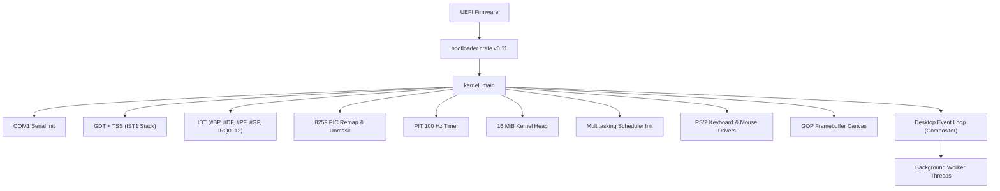

> [!CAUTION]
> **STRICT LEGAL & COPYRIGHT WARNING:**
> **All source code, kernel architecture, designs, documentation, and assets in this repository are strictly copyrighted by JOJIN JOHN ([@jojin1709](https://github.com/jojin1709)).** Copying, cloning, mirroring, redistributing, or using any part of this code or project without explicit prior written permission from the author is **STRICTLY PROHIBITED** and will result in immediate legal action, DMCA takedown notices, and civil/criminal copyright infringement proceedings.

<div align="center">

# TriOS

### An operating system merging the best of Windows, Linux and Android — written in Rust from scratch.

**Developed by [JOJIN JOHN](https://github.com/jojin1709)**

<p><strong>no_std x86_64 &nbsp;•&nbsp; UEFI Native &nbsp;•&nbsp; Preemptive Scheduler &nbsp;•&nbsp; Composited GUI Desktop</strong></p>

```powershell
# Build and run the interactive GUI directly in VirtualBox
cargo build --release
powershell -ExecutionPolicy Bypass -File .\run-gui.ps1
```

---

[](https://www.rust-lang.org/)
[](https://doc.rust-lang.org/nightly/rustc/platform-support/x86_64-unknown-none.html)
[](https://crates.io/crates/bootloader)
[](LICENSE)
[](https://www.linkedin.com/in/jojin-john/)

---

</div>

> [!TIP]
> **Visual Live Demo:** Run `powershell -ExecutionPolicy Bypass -File .\run-gui.ps1` to open the active VirtualBox window directly with full mouse & keyboard controls.

## Table of Contents

- [Overview](#overview)
- [Architecture & Status](#architecture--status)
- [Key Features](#key-features)
- [Live Preview](#live-preview)
- [Quick Start](#quick-start)
  - [Prerequisites](#prerequisites)
  - [Build](#build)
  - [Run in VirtualBox](#run-in-virtualbox)
- [Desktop & Controls](#desktop--controls)
  - [Keyboard Shortcuts](#keyboard-shortcuts)
  - [Mouse & Keyboard Fallback](#mouse--keyboard-fallback)
- [Project Layout](#project-layout)
- [Boot Sequence](#boot-sequence)
- [Roadmap](#roadmap)
- [License](#license)

---

## Overview

TriOS is a modern, bare-metal operating system built from the ground up in Rust without any standard library (`#![no_std]`). It boots via UEFI into a 32-bit color GOP framebuffer, initializes hardware interrupt controllers, programs the timer, sets up virtual memory with a 16 MiB heap, and boots into a fully interactive graphical window manager powered by an event-driven loop and a preemptive multitasking kernel scheduler.

---

## Architecture & Status

TriOS has completed **Phase 0 through Phase 12**:

| Phase | Milestone | Status | Key Subsystems |
| :--- | :--- | :---: | :--- |
| **Phase 0** | Bootloader & Image Build | **Done** | UEFI boot, direct physical memory map, dual-target cargo workspace |
| **Phase 1** | Bare-Metal CPU Core | **Done** | GDT/TSS with IST1 stack, IDT, 8259 PIC remapping, PIT 100 Hz, COM1 UART serial, 16 MiB heap |
| **Phase 2** | Framebuffer & Graphics | **Done** | Double-buffered GOP canvas, 8×8 bitmap font renderer, drawing primitives |
| **Phase 3** | Input & Window Manager | **Done** | PS/2 keyboard & mouse drivers, event queue, z-ordered window manager (drag, resize, focus, close) |
| **Phase 4** | Shell, VFS & Text Fields | **Done** | In-memory RAM filesystem (`ramfs`), TextInput widgets, Files Explorer, Text Editor, Terminal shell |
| **Phase 5** | Preemptive Multitasking | **Done** | Thread control blocks, cooperative/preemptive scheduler, context switching (`switch_context`), background worker |
| **Phase 6** | User Descriptors & Syscalls | **Done** | GDT User DPL-3 code/data, TSS RSP0 privilege stack, IA32_EFER/STAR/LSTAR/FMASK MSRs, fast `syscall` dispatcher |
| **Phase 7** | PCI Bus & AHCI SATA Driver | **Done** | PCI configuration space scanner, AHCI Generic Host Control MMIO, SATA disk device detection |
| **Phase 8** | Standalone ELF Loader & Exec | **Done** | ELF64 header & PT_LOAD segment parser, page table NO_EXECUTE clearing, binary execution via terminal (`elfinfo`, `elfrun`) |
| **Phase 9** | Persistent Storage & FAT VFS | **Done** | GUID Partition Table (GPT) parser, AHCI DMA sector reading, FAT12/16/32 volume mounter, disk traversal (`gpt`, `fatls`, `disks`) |
| **Phase 10** | Intel E1000 NIC & Network Stack | **Done** | Intel 82540EM MMIO driver, RX/TX DMA rings, Ethernet II framing, ARP cache/resolution, IPv4 dispatcher, ICMP Echo ping client (`ping`, `arp`, `netinfo`) |
| **Phase 11** | UDP, DNS Resolver & CMOS RTC | **Done** | UDP datagram framing, RFC 1035 DNS client over port 53 (`dns <host>`), hardware CMOS RTC driver (`date`), live Taskbar clock widget |
| **Phase 12** | ACPI Subsystem & Power Control | **Done** | RSDP/XSDT parser, FADT PM1a control, MADT CPU core counting, ACPI S5 shutdown (`poweroff`), hardware reboot (`reboot`), `acpi` inspection |
| **Phase 13** | TCP Protocol & HTTP/1.0 Client | **Done** | RFC 793 TCP state machine (SYN/ACK, seq/ack tracking), bare-metal HTTP/1.0 client (`curl <url>`) |
| **Phase 14** | Desktop Web Browser Application | **Done** | GUI Browser app (`Ctrl+4`) with address bar, HTML tokenizer, formatted layout, and scrolling |
| **Phase 15** | System Monitor & Task Manager | **Done** | Real-time CPU/RAM gauges, thread table, compositor FPS telemetry, and background worker spawning (`Ctrl+5`) |
| **Phase 16** | Modern Desktop UI/UX & TriSweeper | **Done** | Desktop shortcut icons, modern taskbar with active indicators, window controls (`_`, `□`, `✕`), and TriSweeper puzzle game (`Ctrl+6`) |

---

## Key Features

- **Desktop UI/UX Overhaul & Shortcut Icons (Phase 16)**: Modern desktop shell with 6 clickable desktop shortcut icons (`This PC`, `Files`, `Editor`, `Terminal`, `Browser`, `Mines`), refined Slate & Charcoal palette, 3D window elevation shadows, window controls (`_`, `□`, `✕` with red hover), and taskbar running indicator pills.
- **TriSweeper Retro Desktop Game (Phase 16)**: Interactive 9x9 Minesweeper game (`Ctrl+6`) with 10 hidden mines, first-click protection, recursive zero-neighbor flood fill, HUD with live mine counter, timer, reset face button (`:-) / B-) / X-(`), and Dig/Flag modes.
- **System Monitor & Task Manager (Phase 15)**: Graphical task manager displaying real-time CPU telemetry (core count, TSC frequency, uptime), physical memory & heap usage gauges with visual progress bar, compositor FPS & network telemetry, and live kernel thread table with interactive background task spawning (`Ctrl+5` or taskbar button).
- **GUI Web Browser Application (Phase 14)**: Interactive desktop web browser window featuring a URL address bar, 'Go' button, Enter key navigation, HTML tag tokenizer and text formatting engine, and scrollable viewport with line counter footer, accessible via taskbar button or `Ctrl+4` hotkey.
- **TCP Protocol Stack & HTTP/1.0 Web Client**: Full RFC 793 Transmission Control Protocol (pseudo-header checksums, 3-way handshake SYN/SYN-ACK/ACK, stream transmission, and FIN/ACK teardown) and bare-metal HTTP/1.0 client (`curl <url>`) resolving DNS and fetching live web pages directly over the Internet from within the bare-metal OS.
- **ACPI Power Management & Hardware Reset**: Full ACPI table discovery (RSDP, XSDT, FADT, MADT, DSDT AML), CPU core detection, ACPI S5 poweroff (`poweroff`), and hardware reboot (`reboot`).
- **UDP Protocol & RFC 1035 DNS Resolver**: User Datagram Protocol over IPv4 and domain name resolution querying DNS servers (`10.0.2.3:53`) to resolve Internet hosts into IP addresses (`dns example.com -> 104.20.23.154`).
- **Hardware CMOS Real-Time Clock (RTC)**: Reads calendar date and time from motherboard I/O ports `0x70`/`0x71`, presenting a live wall clock in the desktop Taskbar and via terminal command `date`.
- **Gigabit Ethernet & Network Protocol Stack**: Intel 82540EM (e1000) NIC driver with hardware DMA rings, full Ethernet II framing, dynamic ARP cache & reply engine, IPv4 packet handling, and ICMP Echo ping client/server.
- **Persistent Disk & FAT Filesystem**: Scans GPT partition tables from SATA disks, mounts FAT12/16/32 volumes via AHCI DMA reads, and navigates directories.
- **Standalone ELF64 Executable Loader**: Parses standard 64-bit ELF binaries, maps PT_LOAD segments, configures executable page permissions, and spawns user processes.
- **Preemptive Kernel Multitasking**: Round-robin thread scheduler running background threads concurrently with the desktop GUI event loop.
- **Interactive Window Manager**: Real-time window dragging, resizing via bottom-right grip, focus switching, and z-ordering.
- **Built-in Shell Applications**:
  - **SysMon**: Real-time system monitor & task manager with memory gauges, CPU stats, and thread table (`Ctrl+5`).
  - **Browser**: Graphical web browser over TCP/HTTP with address bar, HTML formatting, and scrolling (`Ctrl+4`).
  - **Terminal**: Interactive CLI supporting commands (`help`, `uptime`, `clear`, `elfinfo`, `elfrun`, `disks`, `gpt`, `fatls`, `netinfo`, `arp`, `ping`, `date`, `dns`, `tcp`, `curl`, `acpi`, `poweroff`, `reboot`, `Ctrl+3`).
  - **Files Explorer**: Interactive directory browsing of the in-memory virtual filesystem (`Ctrl+1`).
  - **Text Editor**: Live text buffer editing with load and save integration into `ramfs` (`Ctrl+2`).
  - **Welcome & Playground**: Demo widgets showcasing buttons, click counters, sliders, and progress bars.
- **Dual Input Drivers**: Native PS/2 mouse and keyboard decoders with automatic arrow-key keyboard mouse emulation if hypervisor mouse capture is unavailable.
- **Hardware Telemetry & Logging**: Real-time TSC calibration, COM1 serial output, and per-frame performance tracking.

---

## Live Preview

<div align="center">


*Live TriOS desktop running inside VirtualBox: Welcome, Terminal, Files Explorer, Editor, and bottom Taskbar.*

</div>

---

## Quick Start

### Prerequisites

| Tool | Version / Notes |
| :--- | :--- |
| **Rust Nightly** | Pinned in `rust-toolchain.toml` (auto-installed by rustup) |
| **Target `x86_64-unknown-none`** | Bare-metal kernel target |
| **Oracle VirtualBox** | Version 7.x (verified with 7.2.14) |

### Build

```powershell
# Clone and enter directory
cd D:\trios

# Build release UEFI disk image (recommended)
cargo build --release
```

The UEFI disk image will be generated at:
`target/release/trios-uefi-release.img`

### Run in VirtualBox

```powershell
# Option A: Launch directly into interactive GUI window
powershell -ExecutionPolicy Bypass -File .\run-gui.ps1

# Option B: Run automated test harness (headless with scancode injection)
powershell -ExecutionPolicy Bypass -File .\run-virtualbox.ps1
```

> [!NOTE]
> All VirtualBox machine state is stored cleanly inside `.vbox-home/` in the workspace without polluting your global user directories.

---

## Desktop & Controls

### Keyboard Shortcuts

| Shortcut | Action |
| :--- | :--- |
| **Ctrl + 1** | Focus and open **Files Explorer** |
| **Ctrl + 2** | Focus and open **Text Editor** |
| **Ctrl + 3** | Focus and open **Terminal** |
| **Ctrl + 4** | Focus and open **Web Browser** |
| **Ctrl + 5** | Focus and open **System Monitor / Task Manager** |
| **Ctrl + 6** | Focus and open **TriSweeper (Minesweeper Game)** |
| **Esc** | Close currently focused window |
| **Arrow Up / Down** | Navigate items in Files Explorer or scroll terminal / browser |

### Mouse & Keyboard Fallback

- **Real Mouse**: Left-click to focus, drag titlebars to move, drag bottom-right corner grip to resize.
- **Keyboard Cursor Fallback**: If mouse integration is disabled in VirtualBox:
  - **Arrow Keys**: Move the cursor (hold `Shift` for fine 4px steps).
  - **Space / Enter**: Left-click at the current cursor position.

---

## Project Layout

```text
D:\trios\
├── Cargo.toml                 # Workspace root & image configuration
├── build.rs                   # UEFI kernel image packer
├── rust-toolchain.toml        # Pinned nightly compiler & components
├── run-gui.ps1                # 1-click interactive VirtualBox launcher
├── run-virtualbox.ps1         # Automated test script with COM1 serial dump
└── kernel/
    ├── Cargo.toml             # Kernel crate dependencies
    └── src/
        ├── main.rs            # Kernel entry point & desktop event pump
        ├── sched/             # Phase 5: Multitasking & Scheduler
        │   ├── mod.rs         # Round-robin scheduler & thread queues
        │   ├── thread.rs      # Thread control block (TCB) & stack alloc
        │   └── context.rs     # Naked assembly context switch & trampoline
        ├── apps/              # Phase 4: Userland Shell Apps
        │   ├── explorer.rs    # File Explorer
        │   ├── editor.rs      # Text Editor
        │   └── terminal.rs    # Command Terminal
        ├── fs/                # In-memory virtual filesystem (ramfs)
        ├── gui/               # Window manager, themes, and widgets
        ├── input/             # PS/2 keyboard & mouse input drivers
        ├── graphics/          # Double-buffered GOP canvas & font engine
        ├── interrupts.rs      # IDT, PIC remapping & IRQ handlers
        ├── gdt.rs             # GDT & Task State Segment (TSS)
        ├── timer.rs           # PIT 100 Hz timer & uptime clock
        ├── allocator.rs       # 16 MiB heap linked-list allocator
        └── serial.rs          # COM1 UART logger
```

---

## Boot Sequence



---

## Roadmap

- [x] **Phase 0**: UEFI Bootloader & raw image packaging pipeline
- [x] **Phase 1**: Core kernel fundamentals (GDT, TSS, IDT, PIC, PIT, Heap, COM1 Serial)
- [x] **Phase 2**: Graphics canvas, font rendering, double-buffered framebuffers
- [x] **Phase 3**: PS/2 keyboard & mouse input drivers, window manager & composited GUI
- [x] **Phase 4**: In-memory virtual filesystem (ramfs), Terminal, Text Editor, Files Explorer
- [x] **Phase 5**: Kernel threads, context switching & round-robin preemptive scheduler
- [x] **Phase 6**: Ring 3 User Descriptors, TSS RSP0 switching, fast `syscall`/`sysret` MSRs & dispatcher
- [x] **Phase 7**: PCI bus enumeration & AHCI SATA block storage driver
- [x] **Phase 8**: Standalone ELF64 executable loader & live execution via terminal (`elfinfo`, `elfrun`)
- [x] **Phase 9**: Persistent FAT32 / FAT16 / FAT12 filesystem & GPT partition mounting
- [x] **Phase 10**: CMOS Real-Time Clock (RTC) date/time hardware decoder
- [x] **Phase 11**: UDP protocol stack & RFC 1035 bare-metal DNS client resolver
- [x] **Phase 12**: ACPI table discovery (RSDP, XSDT, FADT, MADT, DSDT) & hardware power management (`poweroff`, `reboot`)
- [x] **Phase 13**: Full RFC 793 TCP protocol stack (SYN/ACK 3-way handshake) & bare-metal HTTP/1.0 client (`curl`)
- [x] **Phase 14**: Interactive GUI Web Browser application (`Ctrl+4`)
- [x] **Phase 15**: Real-time System Monitor & Task Manager with live CPU, memory gauges, thread table (`Ctrl+5`)

---

## Developer & Contact

**TriOS** is designed, created, and actively developed by **[JOJIN JOHN](https://github.com/jojin1709)**.

- **LinkedIn**: [linkedin.com/in/jojin-john](https://www.linkedin.com/in/jojin-john/)
- **GitHub**: [@jojin1709](https://github.com/jojin1709)

---

## License & Legal Notice

**Copyright (c) 2026 JOJIN JOHN. All Rights Reserved.**

> [!CAUTION]
> **LEGAL WARNING:**
> No part of this software, including source code, architecture, design, documentation, or assets, may be copied, reproduced, cloned, mirrored, modified, published, distributed, or used in any form without the express prior written permission of **JOJIN JOHN**.
> 
> Unauthorized copying, scraping, plagiarism, or distribution constitutes willful copyright infringement and will be met with immediate legal prosecution and DMCA enforcement. See [LICENSE](LICENSE) for full details.
