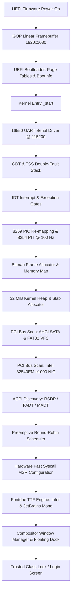

# TriOS Boot Pipeline & System Initialization

This document outlines the end-to-end boot sequence of the TriOS operating system, from firmware power-on to user desktop presentation.

---

## 1. Boot Flow Architecture

---

## 2. Boot Stage Breakdown

### Stage 1: UEFI Firmware & Bootloader
- The host system (or virtual machine like VirtualBox/QEMU) powers on in 64-bit UEFI mode.
- UEFI Graphics Output Protocol (GOP) negotiates a 1920x1080 32-bit linear framebuffer.
- The Rust `bootloader` crate parses the kernel ELF binary, builds identity/direct page mappings, prepares the physical memory region descriptors, and jumps to `_start`.

### Stage 2: Hardware Architecture Initialization
- **Serial Port**: COM1 (port `0x3F8`) initialized at 115200 baud for instant boot telemetry.
- **GDT (Global Descriptor Table)**: Programmed with Kernel Code (`0x08`), Kernel Data (`0x10`), User Code (`0x23`), and User Data (`0x1B`). A Task State Segment (TSS) is loaded with a dedicated 16 KiB double-fault interrupt stack.
- **IDT (Interrupt Descriptor Table)**: 256 gates configured for CPU exceptions (Divide-by-zero, Page Fault, General Protection Fault) and hardware IRQs.
- **Legacy Interrupts & PIT**: Dual 8259 PICs remapped to vectors `0x20..0x2F`. The 8254 Programmable Interval Timer (PIT) is calibrated to 100 Hz (10 ms ticks) on IRQ0.

### Stage 3: Memory Systems
- **Bitmap Allocator**: Tracks all physical 4 KiB frames using a global bit array parsed from UEFI memory descriptors.
- **Kernel Heap**: Virtual memory mapped from `0x4444_4444_0000` to `0x4444_4644_0000` (32 MiB). Uses 7 slab allocator bins (32B to 2048B) and a linked list allocator for large allocations.

### Stage 4: Drivers, Storage & Networking
- **PCI Controller Scan**: Enumerates devices on PCI bus 0.
- **AHCI Storage**: Detects SATA controller BAR5, resets HBA ports, identifies connected hard disks, parses GPT partition tables, mounts FAT32 volume at `/disk`, and registers unified VFS paths.
- **Networking**: Detects Intel 82540EM Gigabit Ethernet NIC, maps MMIO BAR0, configures TX and RX DMA descriptor rings, activates link, initializes ARP table, and assigns static IP `10.0.2.15`.
- **ACPI**: Discovers RSDP via UEFI configuration tables, parses FADT and MADT for CPU core count, and registers hardware poweroff and reboot mechanisms.

### Stage 5: Scheduler & Fast Syscalls
- Preemptive round-robin scheduler initializes kernel threads (network poller, timer, worker threads).
- CPU MSRs (`IA32_STAR`, `IA32_LSTAR`, `IA32_FMASK`, and `EFER.SCE`) are programmed for low-latency Ring 3 system calls.

### Stage 6: Typography, Compositor & GUI
- Fontdue TTF vector rendering engine compiles Inter UI font and JetBrains Mono monospace font.
- Window Manager initializes the wallpaper, desktop shortcuts, taskbar, centered dock, Start menu, Quick Settings panel, and starts at the centered frosted-glass lock screen.
